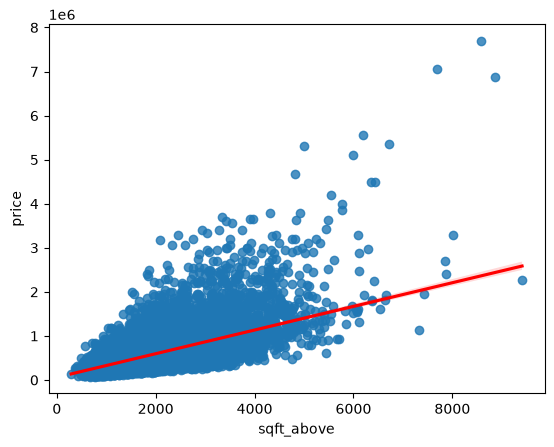

# Tong Chang

Data science student at the University of Macau (UM). I work on turning messy,
real-world data into clear answers — cleaning it, exploring it, modelling it, and
communicating what actually matters in the result.

GitHub: [github.com/Tong-Chang](https://github.com/Tong-Chang) ·
Email: mc63803@um.edu.mo

---

## About me

I am currently studying data visualisation and data analysis as part of my postgraduate
coursework. My focus is on the full analysis chain rather than any single tool: framing a
question that can actually be answered with the data available, preparing the data honestly,
choosing models that match the problem, and being explicit about what the result does *not*
tell you.

## Technical skills

- **Languages:** Python, SQL, R (basic)
- **Data handling:** pandas, NumPy, data wrangling, missing-value treatment
- **Modelling:** scikit-learn, linear and polynomial regression, regularisation (Ridge),
  pipeline construction, train/test evaluation
- **Visualisation:** matplotlib, seaborn, exploratory data analysis
- **Tools:** Jupyter Notebook, Git and GitHub, GitHub Pages

---

## Project showcase

### House Sales in King County, USA — what actually drives price?

**Research question.** A real-estate investment trust wants to enter the residential market
and needs to value properties it has never seen. How accurately can a house's sale price in
King County be predicted from its structural attributes (living area, construction grade,
bedrooms, bathrooms, floors, basement, view, waterfront) and its location — and which of
these attributes carry the most signal?

*Above-ground living area (`sqft_above`) plotted against sale price, with a fitted
regression line. The upward slope confirms a positive relationship, while the widening
spread at higher areas shows that size alone becomes a poorer predictor as houses get
larger.*

**What I found**

- **Size dominates.** Living area is the single strongest correlate of price (r = 0.702) and
  on its own explains about half the variance (R² = 0.493).
- **Neighbourhood beats room count.** The living area of the 15 nearest neighbours
  (r = 0.585) predicts price far better than the number of bedrooms (r = 0.309). Location
  quality matters more than bedroom count.
- **Raw geography is misleading.** Latitude helps (r = 0.307), longitude is nearly useless
  in a linear model (r = 0.022), and zipcode treated as a plain number is actively harmful
  (r = −0.053).
- **Non-linear terms deliver the biggest gain.** Ridge regression with a 2nd-degree
  polynomial expansion lifts R² on held-out data from 0.648 to 0.700, the largest single
  improvement from any modelling change.
- **Waterfront is a different market segment, not just a premium.** Waterfront properties
  show notably more extreme high-price outliers than non-waterfront ones.

**Limitation.** The strongest headline figure (R² = 0.751) is computed in-sample on the
whole dataset, so it is optimistic and not directly comparable with the 0.700 held-out test
result. Only the two Ridge models were evaluated on a true test split, and those rely on a
single fixed split rather than cross-validation. The data also covers just one county over
twelve months in 2014–2015, so it says nothing about other markets or later periods.

**Links and status**

- Repository: [github.com/Tong-Chang/.data-science-project](https://github.com/Tong-Chang/.data-science-project)
- Notebook: `house_price_prediction_king_county.ipynb`
- **Status: Completed**

---

## Notes on this site

Built with GitHub Pages from this repository's `main` branch. All content is public; no
credentials, personal data, or restricted datasets are published here.
